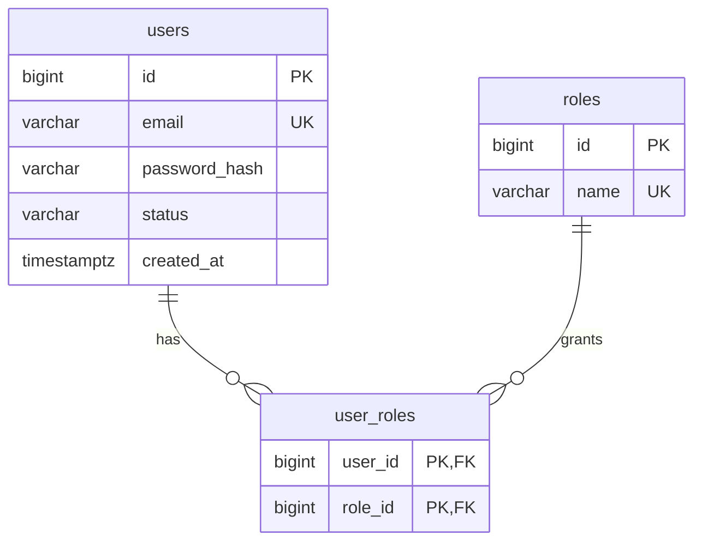

# dVault

A modular monolith for private file storage, secure sharing and URL shortening.
The application currently provides a responsive React workspace, registration and session authentication APIs, CSRF protection, and automated verification. Account forms/profile screens and domain features are subsequent modules; navigation shows release status rather than fabricated file or analytics data.

## Development setup

Requirements: Java 21, Node.js 24, PostgreSQL 17, and network access for the first dependency download. Maven 3.9.11 is downloaded by the committed Maven wrapper. Spring Boot is pinned to 3.5.16; React/TypeScript/Vite dependencies are pinned by `frontend/package-lock.json`.

Create a local PostgreSQL database and set `DB_URL`, `DB_USERNAME`, and `DB_PASSWORD` in your shell using `.env.example` as a reference. The application does not automatically load `.env` files. Never commit real credentials. Set `COOKIE_SECURE=true` behind HTTPS in production.

```powershell
$env:DB_URL='jdbc:postgresql://localhost:5432/dvault'
$env:DB_USERNAME='<your local database user>'
$env:DB_PASSWORD='<your local database password>'
cd frontend
npm ci
npm test
npm run build
cd ../backend
.\mvnw.cmd -B verify
.\mvnw.cmd spring-boot:run
```

On Linux/macOS use `export` for environment variables and `./mvnw` for Maven. For interactive frontend development run `npm run dev` inside `frontend`; Vite proxies `/api` and `/u` to port 8080. The frontend build is copied into the Spring Boot jar when built before Maven. Production uses the same origin; `java -jar backend/target/dvault-0.1.0-SNAPSHOT.jar` serves the built workspace at port 8080.

## Architecture and shared contracts

- Backend: Java 21 / Spring Boot, Spring Security, JPA, Flyway and PostgreSQL. Feature packages are `com.dvault.auth`, `user`, `vault`, `storage`, `sharing`, `shortener`, `analytics`, `admin`, `security`, and `common`. Add packages when implementing their features. Controllers call services; services own transactions and use repositories/adapters. Return DTOs, never entities or storage object keys.
- Frontend: React + TypeScript + Vite. `src/components.tsx` supplies labeled fields, a native focus-trapping dialog, loading and retryable error states. `src/api.ts` centralizes same-origin session requests and CSRF headers. No authentication tokens in localStorage.
- Database: PostgreSQL only; Hibernate validates the schema and Flyway manages changes. `V001__users_and_roles.sql` creates users, roles and the user_roles join table. USER and ADMIN are the project-approved roles; anonymous visitors are not stored as a role. Rana assigns the next globally increasing migration version in actual merge order; never edit an applied migration. ERD and resource API details will be added with their implementing modules.
- Session security: CSRF protection stays enabled, session cookies are HttpOnly and SameSite=Lax, anonymous requests cannot read private APIs. Registration always assigns USER. Login verifies BCrypt passwords, rotates the session ID and resets CSRF, then explicitly persists authentication in the server session. Logout invalidates the session and expires its cookie. Requests under `/api/admin/**` require ADMIN; status is rechecked for existing sessions so suspended/deleted accounts are denied. Framework-generated accounts, HTTP Basic, remember-me and browser form-login redirects are disabled. Idle sessions expire after 30 minutes.
- Errors: Authentication validation and security failures use `{status,code,message,path,timestamp,fieldErrors}`. `fieldErrors` maps field names to messages; timestamps use UTC ISO-8601. Validation is 400, authentication 401, authorization 403, missing resource 404, conflict 409, expired link 410, upload limit 413 and rate limit 429. Clients must also tolerate non-JSON proxy errors.

## API and authentication

| Method | Path | Response |
| --- | --- | --- |
| GET | `/api/health` | `200 {"status":"UP"}`; process health, no private details |
| GET | `/api/auth/csrf` | `200 {"headerName":"X-CSRF-TOKEN","token":"…"}`; session-bound, masked CSRF token |
| POST | `/api/auth/register` | JSON `{email,password}` → `201 {id,email,roles:["USER"]}`; does not sign in automatically |
| POST | `/api/auth/login` | JSON `{email,password}` → `200 {id,email,roles}` and rotated session |
| GET | `/api/auth/session` | `200 {id,email,roles}` for the current session, otherwise 401 |
| POST | `/api/auth/logout` | 204 after session invalidation; requires CSRF |

The client retrieves CSRF before mutation and sends the returned header with same-origin cookies. Call `refreshCsrf()` after successful login and logout, then use `request<T>()` for subsequent API calls. Successful 204 responses return `undefined`. Do not retry mutations automatically. `frontend/src/auth.ts` provides typed register/login/logout/session functions and refreshes CSRF after successful login/logout. Account forms, route guards and `/api/users/me` profile functionality are intentionally scheduled for the next account UI module.

Email is stripped and lowercased before storage/lookup, with a PostgreSQL unique constraint protecting concurrent registrations. Passwords require 12 or more characters and at most 72 UTF-8 bytes to avoid BCrypt truncation; passwords are not trimmed. DTOs reject extra fields (including client-supplied roles), redact their string representation, and never return passwords or hashes. Duplicate emails produce 409; invalid fields or malformed/extra JSON fields produce 400; invalid, missing or suspended login credentials use the same generic 401 message. Login, registration and logout require a real session CSRF token, including anonymous login requests. `GET /api/auth/csrf` must be called again after authentication changes.

There are no default accounts or public admin signup. Initial ADMIN access must be granted to an existing registered account by the lead through trusted database administration, using the existing ADMIN role and a `user_roles` row. No credentials belong in migrations. New grants require a fresh login; account suspension immediately invalidates existing sessions on their next request. Admin role/user management endpoints are subsequent work. Login rate limiting and email verification are not implemented in this slice.

### Current database relations



Deleting a user cascades to its role assignments; deleting a referenced role is restricted. Future file/share foreign-key behavior remains to be agreed before those migrations.

## Analytics event agreement for implementation

Alok publishes typed click/download events; Rana owns persistence/listeners. Each event carries a UUID `eventId`, UTC `occurredAt`, `ownerId` and `linkId`; downloads also carry `fileId`. No token, code, password or target URL belongs in an event. Publishers emit within their domain transaction, and analytics listeners process only after successful commit in their own transaction. Analytics persistence must enforce unique event IDs for idempotency; a failed listener must not turn a completed redirect/download into a reported failure. The analytics module must document and test recovery of failed event persistence before release. Clicks count accepted redirects; download counts represent atomically reserved authorized attempts, including failed streams. Sharing owns reservation enforcement; analytics never authorizes access. These are proposed integration contracts for peer review, not claims of implemented analytics.

## Verification and collaboration

Run `./mvnw -B verify` from `backend/` (after the frontend build) to execute full-context MockMvc tests against the PostgreSQL configured in the environment. There is no H2 fallback. Frontend checks are `npm ci`, `npm test` and `npm run build`. CI runs **Backend verification** with a fresh PostgreSQL 17 service and **Frontend verification** on PRs targeting develop/main and pushes to those branches. Required checks must be configured after the first successful workflow run, before merging. Integration tests count separately from service unit tests. Registration service tests cover password hashing/USER-only assignment, duplicate-email refusal, and a concurrent unique-constraint failure. PostgreSQL integration checks cover registration, validation and role injection, case-insensitive duplicates, real CSRF tokens, login persistence/session rotation, logout, admin authorization and suspension of existing sessions. CI starts on a clean database; local R2 verification also upgrades the previously initialized R1 database through Flyway. Applied migration checksums remain validated on subsequent startup.

Work uses scoped feature branches and PRs to `develop`, independent approval, resolved conversations, and merge commits. No direct protected-branch writes, automatic merging or deployment is part of this foundation. Containerization and gated main-only Render deployment are later work; no deployment is claimed.
